# TP : Configuration et utilisation de VNC (TigerVNC + tunnel SSH)

**Cours** : Services Réseaux Avancés, L3 GLSI, DGI-ESP 2026-2027
**Enseignant** : Dr GUEYE
**Étudiante** : Fatou Seck

## Objectif

Configurer un serveur VNC sur une machine Linux pour permettre une prise de contrôle distante, puis sécuriser la connexion avec un tunnel SSH.

## Environnement

| Élément | Valeur |
|---|---|
| Serveur | VM Ubuntu 24.04 sous VirtualBox (`fatou-seck-VirtualBox`) |
| Réseau de la VM | Accès par pont, IP `192.168.1.130` |
| Client | PC Windows, IP `192.168.1.5` |
| Serveur VNC | TigerVNC 1.13.1 |
| Client VNC | TigerVNC Viewer |
| Session VNC | display `:2`, port TCP **5902** |

> **Remarque.** Le TP utilise `:1` (port 5901). Sur cette VM, `:1` était déjà occupé par la session graphique d'Ubuntu (message `A X11 server is already running for display :1`). J'ai donc utilisé `:2`, donc le port 5902. Tout le reste est identique.

---

## Partie 1 : Installation et configuration du serveur VNC (dans la VM)

### 1.1 Mise à jour, installation de TigerVNC et de XFCE

```bash
sudo apt update && sudo apt upgrade -y
sudo apt install tigervnc-standalone-server -y
sudo apt install xfce4 xfce4-goodies -y
```

### 1.2 Initialisation du serveur et création du mot de passe

```bash
vncserver :2
```

La commande demande un mot de passe VNC (6 caractères minimum, seuls les 8 premiers sont utilisés par le protocole).

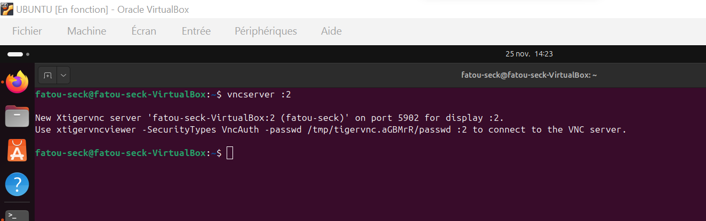

Comportement par défaut : le serveur n'écoute que sur `127.0.0.1`.

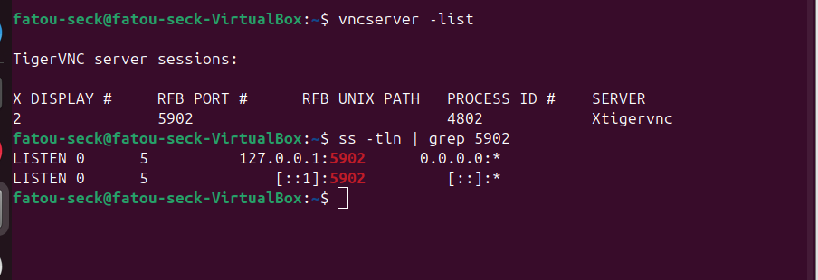

### 1.3 Arrêt, puis configuration de `~/.vnc/xstartup`

```bash
vncserver -kill :2
nano ~/.vnc/xstartup
chmod +x ~/.vnc/xstartup
```

Contenu final du fichier (adapté, voir « Problèmes rencontrés ») :

```bash
#!/bin/bash
unset SESSION_MANAGER
unset DBUS_SESSION_BUS_ADDRESS
export DISPLAY=:2
export XDG_SESSION_TYPE=x11
export XDG_CURRENT_DESKTOP=XFCE
exec dbus-launch --exit-with-session bash -c '
export DISPLAY=:2
xfwm4 --compositor=off > ~/.vnc/xfwm4.log 2>&1 &
sleep 2
xfce4-panel > ~/.vnc/panel.log 2>&1 &
xfdesktop > ~/.vnc/desktop.log 2>&1 &
xfce4-terminal --display=:2 &
wait
'
```

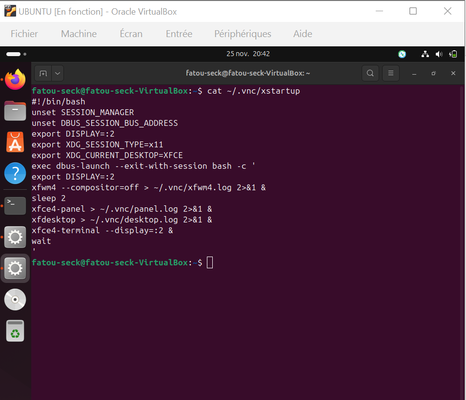

### 1.4 Relance du serveur

Pour la connexion directe de la Partie 2, il faut autoriser les connexions venant du réseau avec `-localhost no`.

```bash
vncserver -kill :2
vncserver :2 -localhost no
ss -tln | grep 5902
```

Le port écoute maintenant sur `0.0.0.0:5902` (au lieu de `127.0.0.1:5902`).

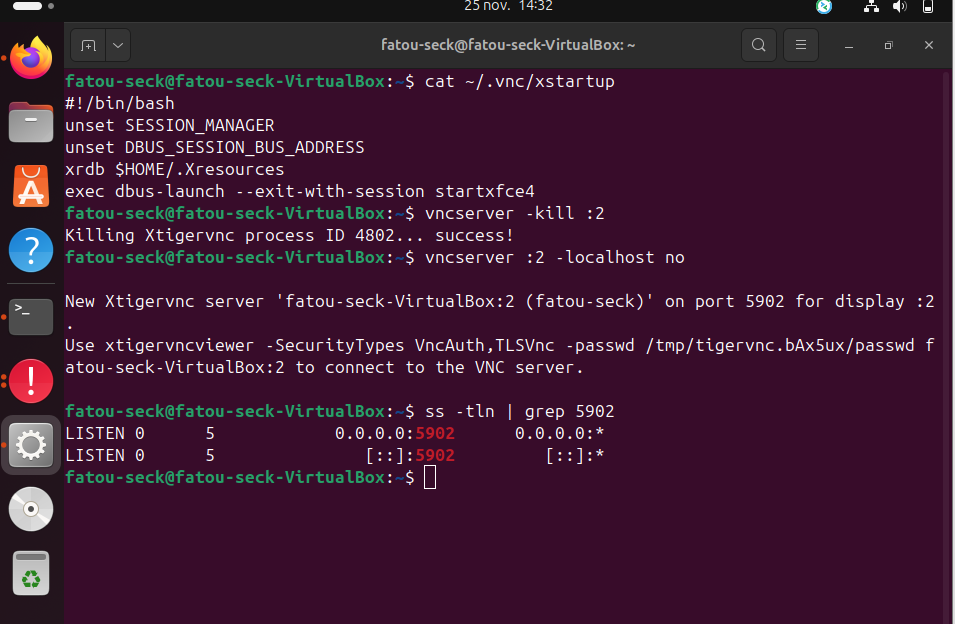

### 1.5 Pare-feu

Le pare-feu `ufw` était actif et bloquait le port. La règle suivante a été ajoutée :

```bash
sudo ufw allow 5902/tcp
```

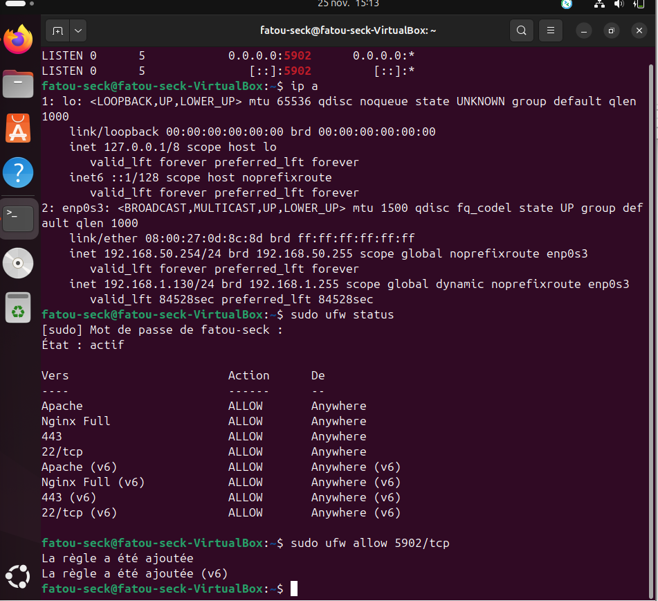

---

## Partie 2 : Connexion directe depuis le client Windows

Le client utilisé est **TigerVNC Viewer**. Adresse saisie : `192.168.1.130:2` (IP:numéro d'affichage, soit le port 5902).

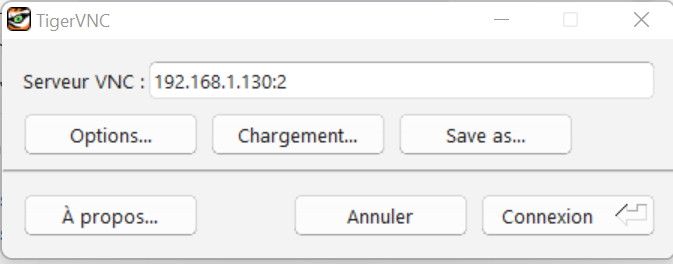

Une fois connecté, la fenêtre « Informations de la connexion VNC » confirme les paramètres du protocole RFB :

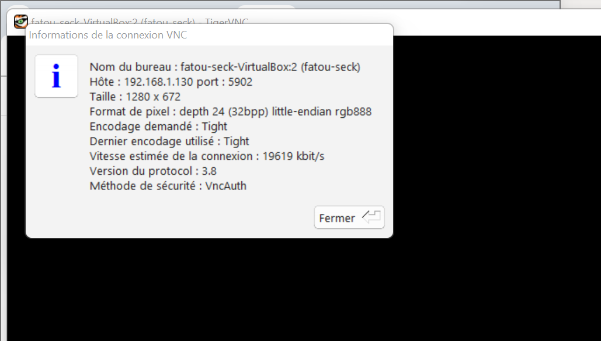

| Paramètre | Valeur | Signification |
|---|---|---|
| Hôte / port | 192.168.1.130 / 5902 | 5900 + display 2 |
| Taille | 1280 x 672 | dimensions du framebuffer |
| Format de pixel | depth 24, rgb888 | négocié à l'initialisation |
| Encodage | Tight | compression des mises à jour |
| Version du protocole | 3.8 | version RFB négociée |
| Sécurité | VncAuth | défi-réponse avec mot de passe |

Test de la prise de contrôle : dans le terminal distant, `hostname` renvoie `fatou-seck-VirtualBox` et `ip a` affiche `192.168.1.130`. C'est bien la VM qui est pilotée depuis Windows.

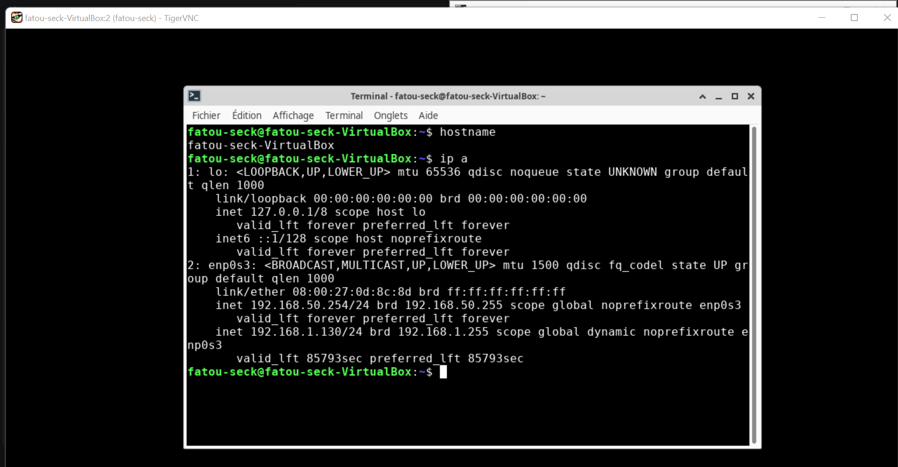

---

## Partie 3 : Sécurisation avec un tunnel SSH

VNC seul n'est pas chiffré. Le tunnel SSH chiffre tout le trafic.

### 3.1 Vérifier que le serveur SSH est actif (VM)

```bash
systemctl status ssh
```

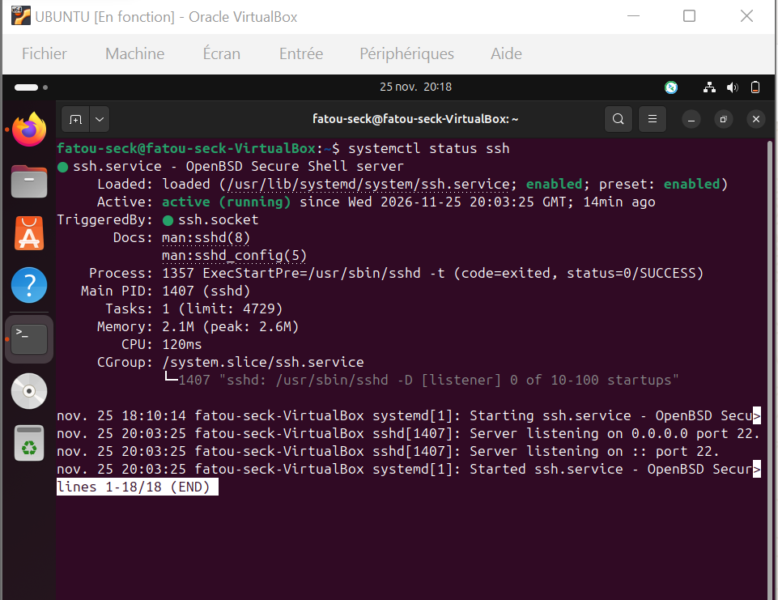

### 3.2 Forcer l'accès par le tunnel (VM)

```bash
vncserver -kill :2
vncserver :2 -localhost yes
ss -tln | grep 5902
```

VNC n'écoute plus que sur `127.0.0.1:5902` : la connexion directe n'est plus possible, seul le tunnel peut atteindre le serveur.

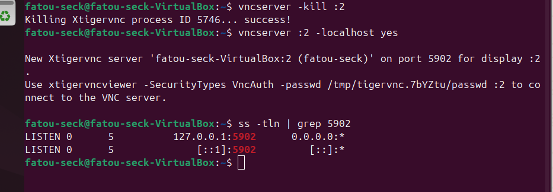

### 3.3 Création du tunnel (Windows, PowerShell)

```powershell
ssh -L 5902:localhost:5902 fatou-seck@192.168.1.130
```

Cette commande relie le port 5902 de Windows au port 5902 de la VM, à travers SSH.

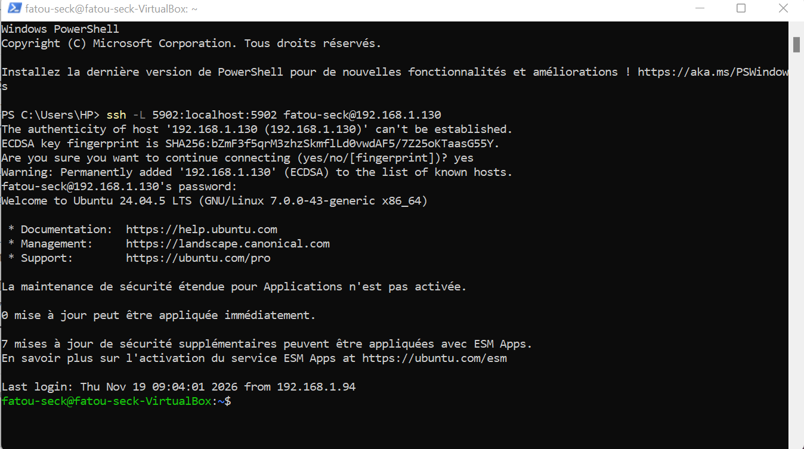

### 3.4 Connexion VNC via le tunnel

Dans TigerVNC, l'adresse devient `localhost:5902` (et non plus l'IP de la VM).

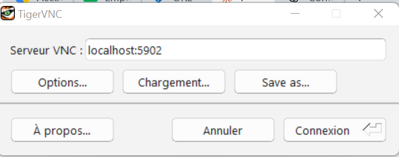

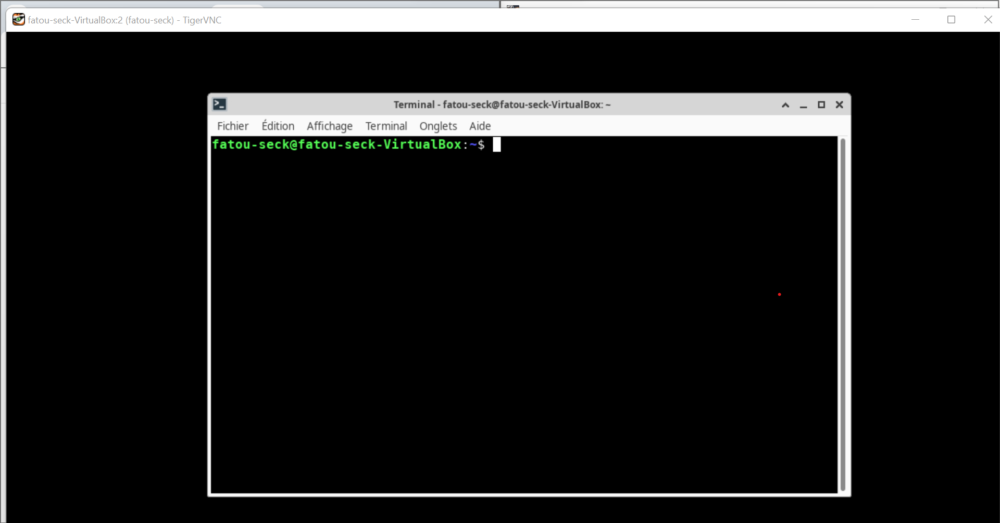

### 3.5 Vérification

Les journaux SSH de la VM montrent la connexion venant du PC Windows (`192.168.1.5`) :

```bash
sudo tail -20 /var/log/auth.log
```

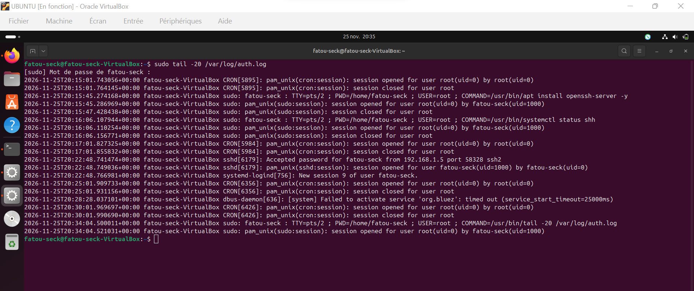

On y lit `Accepted password for fatou-seck from 192.168.1.5` et `session opened for user fatou-seck`. VNC n'étant joignable que sur `127.0.0.1`, tout le trafic VNC (images de l'écran, clavier, souris) est passé par ce tunnel chiffré.

---

## Problèmes rencontrés et solutions

| Problème | Cause | Solution |
|---|---|---|
| `dpkg a été interrompu` à l'installation | Installation précédente interrompue | `sudo dpkg --configure -a` puis `sudo apt --fix-broken install` |
| `A X11 server is already running for display :1` | `:1` occupé par la session Ubuntu | Utilisation de `:2` (port 5902) |
| `Session startup ... cleanly exited too early` | `startxfce4 &` en arrière-plan : le script se termine, TigerVNC 1.13 arrête le serveur | `exec dbus-launch --exit-with-session ...` au premier plan |
| Connexion directe impossible depuis Windows | `vncserver` n'écoute que sur `127.0.0.1` par défaut | Option `-localhost no` |
| `Timed out` (erreur 10060) | Pare-feu `ufw` bloquant le port 5902 | `sudo ufw allow 5902/tcp` |
| Écran noir ou vide dans le viewer | Rendu instable de XFCE sous VirtualBox (conflit avec la session GNOME ouverte) | `xstartup` qui lance `xfwm4`, le panneau et un terminal avec `DISPLAY=:2` |
| RealVNC Viewer impose un compte | Version récente de RealVNC | Utilisation de TigerVNC Viewer (même protocole RFB) |
| IP de la VM changée (`10.0.2.15`) | Réseau en mode NAT | Retour en mode « Accès par pont » (IP `192.168.1.130`) |

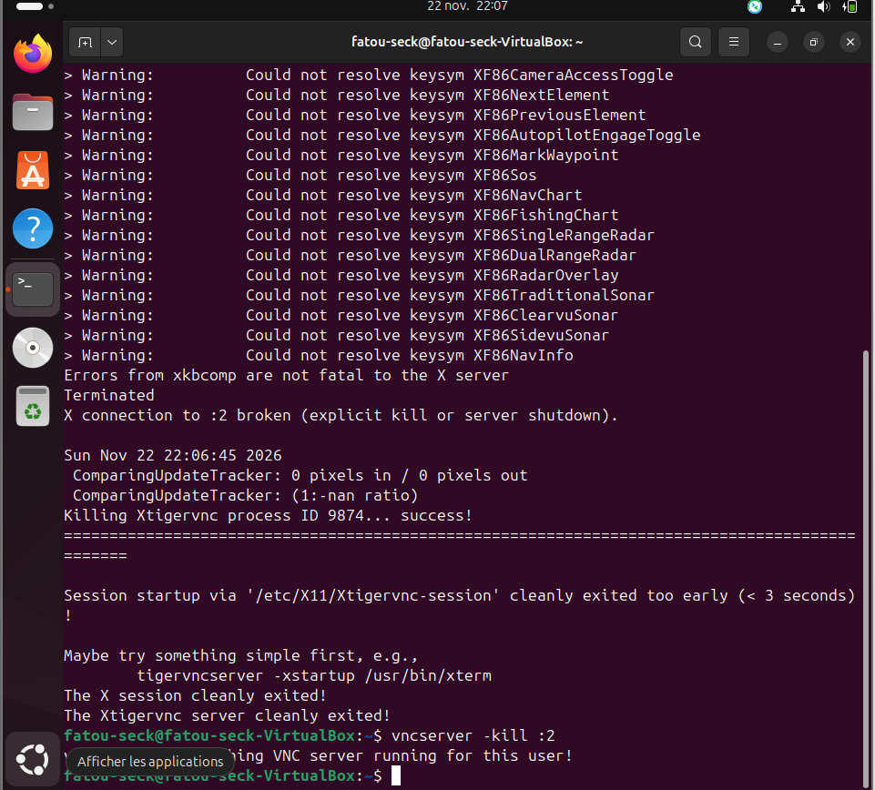

## Limites

Le bureau XFCE ne s'affiche pas avec sa barre et ses icônes dans cet environnement : seul un terminal s'ouvre dans la session distante. La prise de contrôle est fonctionnelle et prouvée (`hostname`, `ip a`), mais le rendu complet du bureau n'a pas pu être obtenu sous VirtualBox.

## Conclusion

Le serveur TigerVNC a été installé et configuré, la prise de contrôle depuis Windows a été validée, puis sécurisée par un tunnel SSH. Le protocole RFB ne chiffre pas ses échanges : le tunnel SSH et la restriction `-localhost yes` sont donc indispensables dès que le serveur est accessible sur un réseau.
